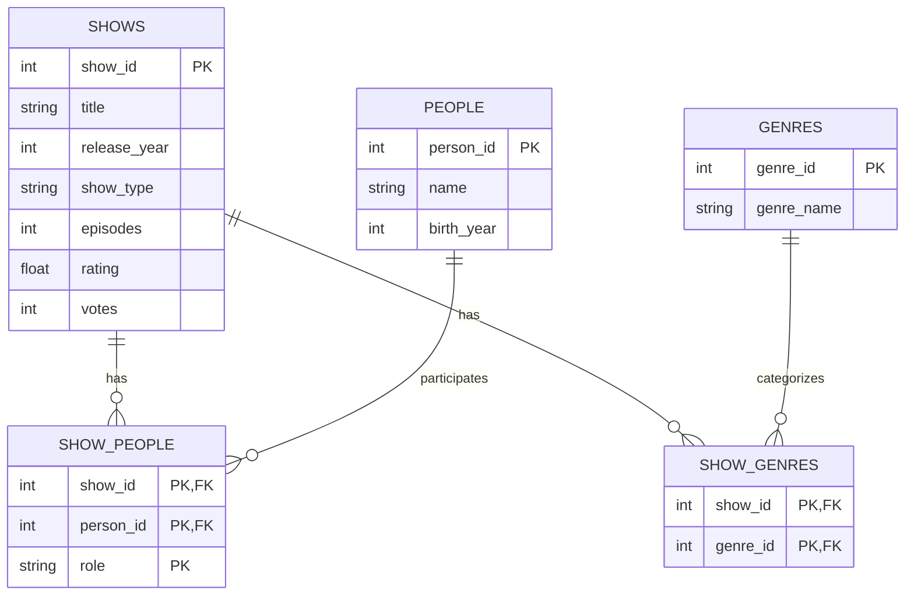

#Assumptions
Each TV show has a unique Show ID, and each person has a unique Person ID, even if names or titles are the same.

A person can work on multiple TV shows, and each show can have multiple actors and writers.

A person can have more than one role in the same show, such as being both an actor and a writer.

A TV show can belong to multiple genres, and each genre can be associated with multiple shows.

Some shows may not have a rating or votes yet, so these fields can be left empty (NULL).

Each person's information is stored only once in the People table, regardless of how many shows they have worked on.