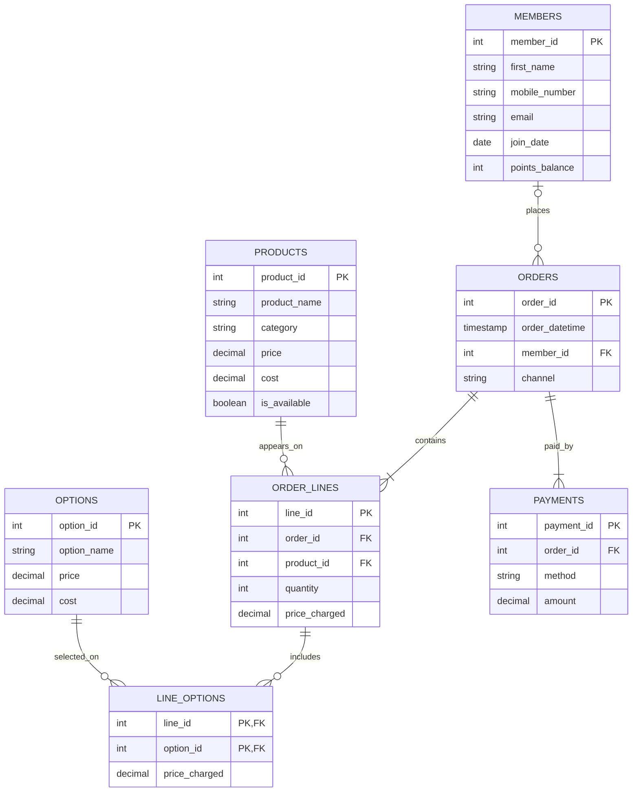

## 1. The Scenario - Option C Babson Bean Cafe

I chose scenario C, Babson Bean Cafe. Babson Bean is a cafe on campus that currently tracks sales through its register and manages its loyalty program using punch cards.

The goal of this database is to organize information about customers, menu products, drink options, orders, and payments. This will allow the café to better understand its sales, identify popular products, evaluate profitability, and track customer loyalty.

## 2. The ERD

## 3. What One Row Means

- **Members:** One row represents one customer enrolled in the café's loyalty program.
- **Products:** One row represents one product offered on the café's menu.
- **Options:** One row represents one add-on that can be selected for a drink.
- **Orders:** One row represents one purchase made at the café, with or without a loyalty member.
- **Order_Lines:** One row represents one product and its quantity within an order.
- **Line_Options:** One row represents one option added to a specific order line.
- **Payments:** One row represents one payment made toward an order.

## 4. Design Choices

**Primary Keys**

I chose to use unique ID numbers as primary keys for members, products, orders, order lines, options, and payments. Although members have mobile numbers, these can change, so using a member ID is more reliable. The line_options table uses a combined primary key of line_id and option_id because the same option cannot appear more than once on a line.

**Optional Relationships**

Not every order is associated with a loyalty member, since non-members can make purchases. Members can also exist without placing any orders. Additionally, an order line does not need to have any options, since customers can purchase products without add-ons. Products and options can exist in the database without being purchased.

**Rules That Cannot Be Enforced by the Tables Alone**

The database cannot use a simple CHECK constraint to confirm that an order's payments equal the total charged for its products and options. This requires information from multiple tables. I will use a SQL query to calculate each order's total and compare it against its payments. This query will identify any differences.

**Design Decision Based on Agent Feedback**

One possible approach was to use a member's mobile number as their primary key. I chose not to use this approach because the scenario states that customers can change their mobile numbers. Instead, I used a unique member ID so that their purchase history remains connected even if their contact information changes.
